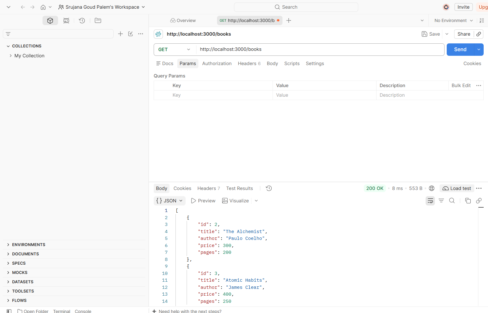
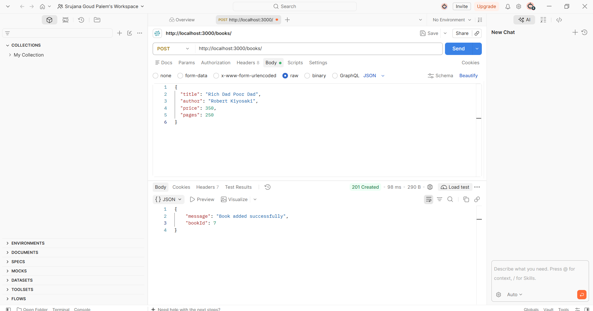
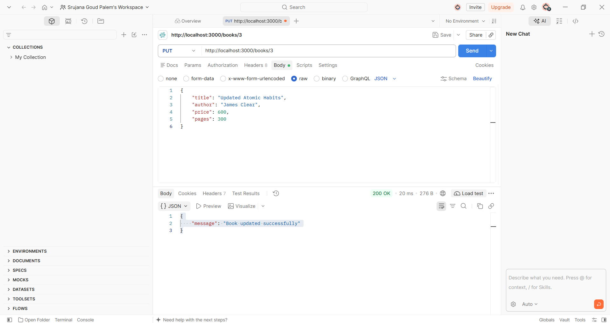
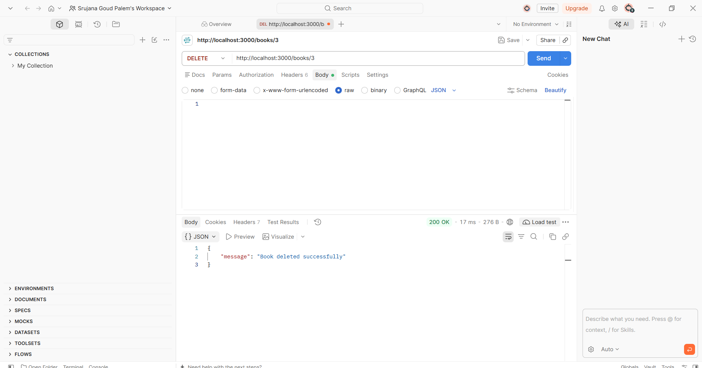
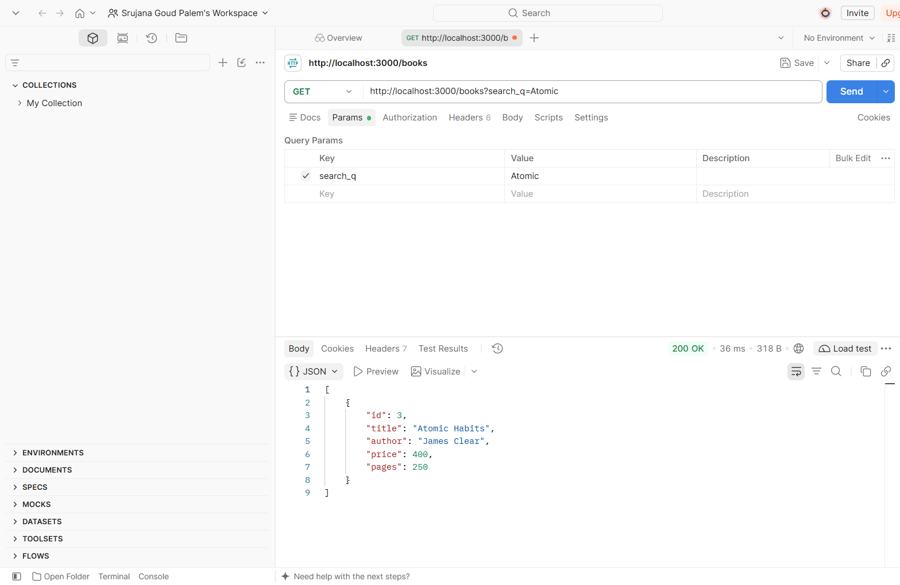
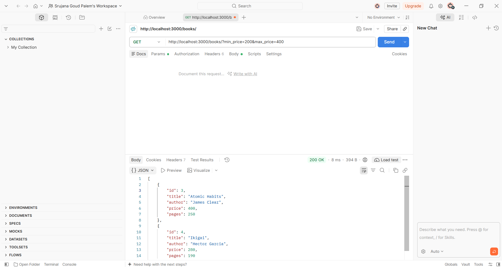
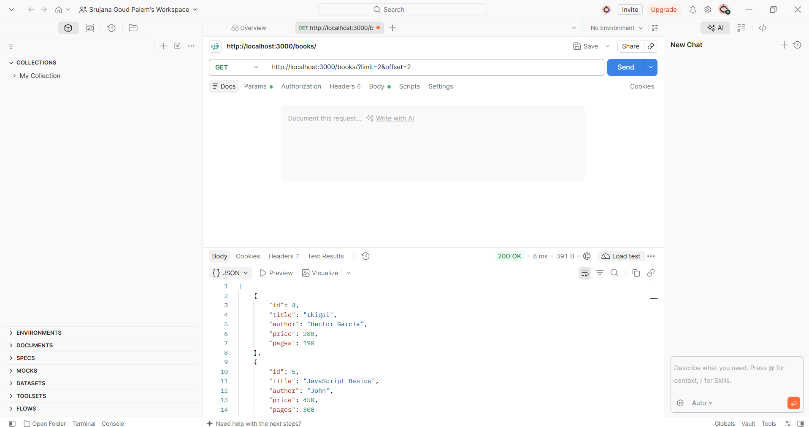
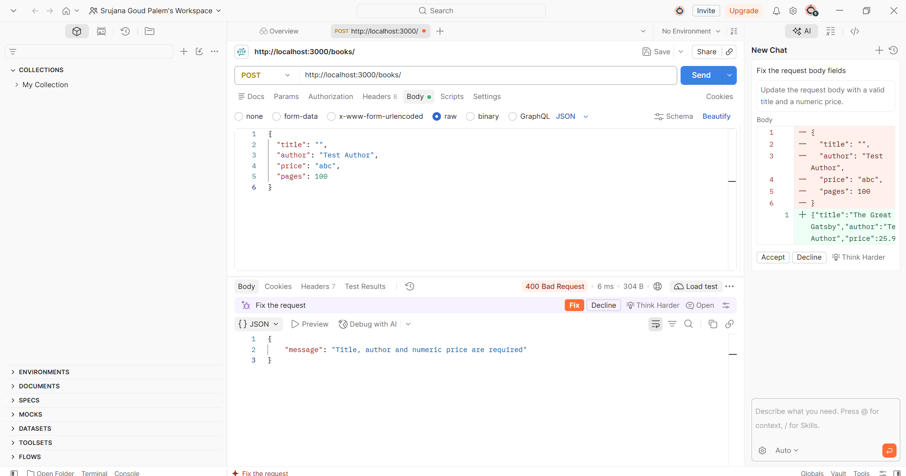
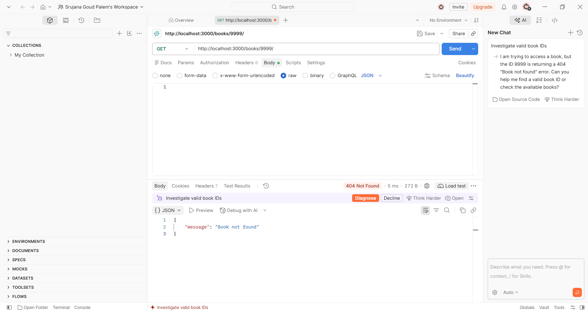

# Lab 3: REST API, Query Parameters and Validation

**Name:** Srujana Goud Palem  
**Registration Number:** 252U1R1177  
**Section:** CSE (2-D)

## Objective

To develop and test a REST API using Node.js, Express.js, and SQLite. The project implements CRUD operations, query parameters, input validation, and error handling.

## Technologies Used

- Node.js
- Express.js
- SQLite
- JavaScript
- Postman
- Visual Studio Code

## How to Run

1. Open the project folder in VS Code.
2. Install the dependencies:

   ```bash
   npm install
   ```

3. Start the server:

   ```bash
   node app.js
   ```

4. Open the API using:

   `http://localhost:3000/books/`

## API Endpoints

| Method | Endpoint | Description |
|---|---|---|
| GET | `/books/` | Get all books |
| GET | `/books/:bookId/` | Get a single book |
| POST | `/books/` | Add a new book |
| PUT | `/books/:bookId/` | Update a book |
| DELETE | `/books/:bookId/` | Delete a book |

## Query Parameters

| Parameter | Description |
|---|---|
| `search_q` | Search books by title or author |
| `order_by` | Sort by title, author, or price |
| `order` | Sort in ascending or descending order |
| `limit` | Limit the number of results |
| `offset` | Skip a specified number of results |
| `min_price` | Filter books by minimum price |
| `max_price` | Filter books by maximum price |

## Input Validation and Error Handling

- Validates required book title and author.
- Validates price and pages.
- Returns appropriate error responses for invalid input.
- Returns a 404 response when a requested book is not found.
- Uses parameterized SQL queries.

## Screenshots

Add your Lab 3 screenshots in the `LAB_3ABD/SCREENSHOTS/` folder and link them below.

## Screenshots
## Screenshots

All Lab 3 Postman testing screenshots are available in the `LAB_3ABD/SCREENSHOTS/` folder.

### CRUD Operations

**GET All Books**



**POST Book**



**PUT Book**



**DELETE Book**



### Search and Filtering

**Search Books**



**Price Range Filter**



**Limit and Offset**



### Sorting

**Sort Books by Title (A–Z)**

.png)

**Sort Books by Author (A–Z)**

.png)

**Sort Books by Price (Ascending – Lowest to Highest)**

.png)

**Sort Books by Price (Descending – Highest to Lowest)**

.png)

### Validation and Error Handling

**Input Validation Error (400 Bad Request)**



**Book Not Found (404 Not Found)**



## Conclusion

Successfully developed and tested a REST API using Node.js, Express.js, and SQLite. Implemented CRUD operations, query parameters, input validation, and error handling using Postman.
